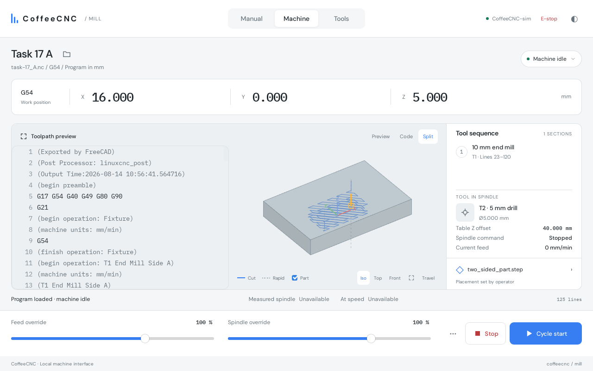
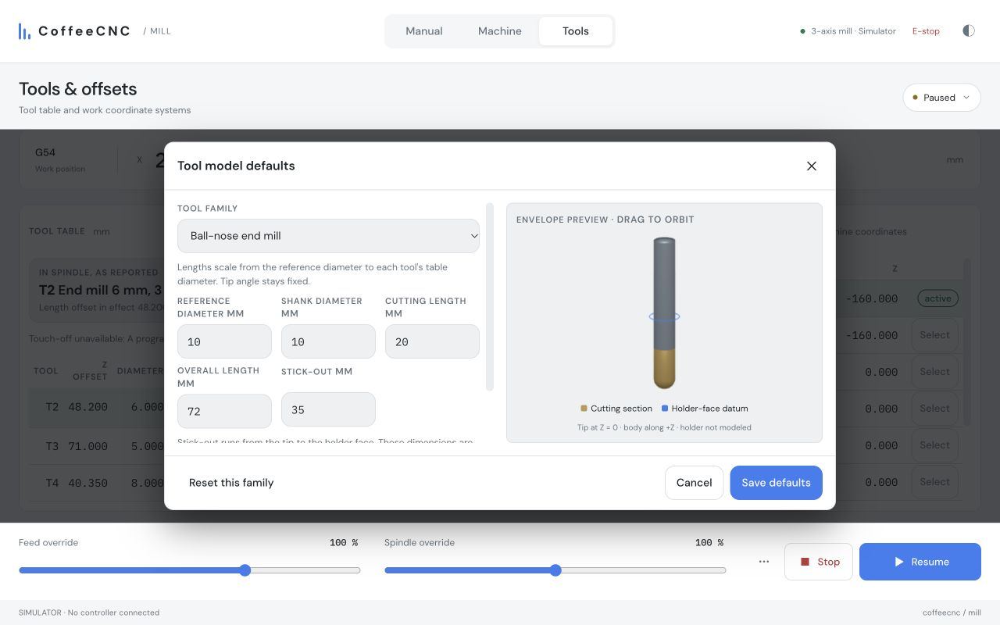

# CoffeeCNC

A new milling frontend for LinuxCNC, with a native C++ core and a modern web interface hosted locally in GTK/WebKit.

CoffeeCNC is an independent product. It shares architectural ideas with [Elle](https://github.com/tinic/el-linuxcnc-electron), the electronic leadscrew project, but has its own milling workflows and product scope.

**Current status: native operator panel running against LinuxCNC simulation.** The C++ executable hosts the Vue/TypeScript panel in GTK/WebKit and connects controller status, program loading, tools and operator commands. Separate command, status and HAL control threads keep heartbeat and jog-stop handling independent of blocked NML commands. A labeled browser simulator remains available for development.

Native interpreter preview, STEP overlay and the tool-model editor now work in LinuxCNC simulation. The [preview](docs/preview.md) supports a bounded subset of G-code and reports unsupported input; persistent job configuration remains in progress. The [native shell reference](docs/shell.md) and [qualification record](docs/research/step-preview.md#native-webkitgtk-qualification) describe tested behavior and sanitizer limits. No hardware operation has been qualified.



*GTK/WebKit running against LinuxCNC simulation, with the unedited Task 17 A program and its associated 120 × 80 × 18 mm STEP stock. The gray block is initial stock; blue lines are interpreter-generated cutting paths. Placement has been applied in the panel. This view does not simulate stock removal or validate a physical setup.*

The first machine target is the **G0759**, using the definitions in [tinic/linuxcnc](https://github.com/tinic/linuxcnc). Machine settings and HAL integration stay separate from shared application code. See [the configuration review and integration gaps](docs/machines/g0759.md).

## Run the operator panel

```sh
cd ui
npm ci
npm run dev
```

Open [the simulated Machine workspace](http://127.0.0.1:5174/?scene=running&tab=program&theme=light). Use the theme control for the dark version. See [UI development and checks](ui/README.md) and [native backend build instructions](backend/README.md).

Use **Attach STEP model** to choose a local `.step`/`.stp` file, adjust opacity and place it in the current work coordinate system. The simulator includes a sample model. Import and display stay local; model placement does not change machine work offsets.

In **Tools**, open **Model defaults** to configure common cutter families, or **Set model** on a tool to select its family and override physical dimensions. The editor includes a live 3D envelope preview. Defaults persist in this browser; per-tool assignments currently last for the page session. The Machine preview places the configured loaded tool at the reported tip, with an independent Tool visibility control. Physical dimensions remain independent of LinuxCNC Z offsets. See [tool model behavior and geometry](docs/design/tool-models.md).



*Live parametric tool editor at 1280 × 800. The blue ring marks the holder-face datum; the cutter and shank are simplified envelopes.*


*The T2 envelope follows the reported tool tip in the browser simulator. Its blue ring marks the holder-face datum; no holder or collision simulation is implied.*

## Explore the concept

Open [the standalone concept](docs/concepts/coffeecnc-mill.html) in a browser after cloning. [The editable fragment](docs/concepts/coffeecnc-mill.fragment.html) is also included. The prototype uses external font and icon resources; it is not an offline production application.

The concept established the panel's visual direction: readable coordinates, a part/toolpath view, operation context, and persistent run controls. Its displayed geometry, measurements, tool readiness and timing are illustrative. The working panel uses that design with jogging, touch-off, tool changes and execution controls exercised against LinuxCNC simulation; machine validation and recovery workflows remain ongoing work.

## Direction

- A native C++ application owns the LinuxCNC connection and command lifecycle.
- GTK/WebKit hosts a local web UI through an in-process message bridge.
- LinuxCNC continues to own motion, interpretation and real-time control.
- Plain G-code is a first-class input. STEP, setup sheets and CAM metadata enrich a job when available.
- Machine state, operator declarations and preview assumptions remain distinguishable.

## Research and design material

- [Machinist workflows](docs/research/machinist-workflows.md): primary sources, proposed operator scenarios and questions for shop observation.
- [Sample catalog](samples/README.md): 117 NC/NGC/GCODE/TAP programs and 29 STEP models from 11 GitHub projects, with native FreeCAD CAM files, setup/tool metadata, pinned provenance and upstream licenses.
- [STEP preview library](docs/research/step-preview.md): selected npm importer, alternatives, corpus checks, browser and native overlay qualification.
- [Concept review](docs/design/concept-review.md): what the attractive first screen gets wrong and what the next design needs.
- [Architecture](docs/architecture.md) and [feasibility](docs/feasibility.md): native/web boundaries, prerequisites and implementation sequence.
- [Frontend landscape in 2026](docs/research/linuxcnc-frontends-2026.md): the original alternatives research.
- [Product brief](docs/product-brief.md) and [material provenance](docs/provenance.md): decisions, assumptions and the archived original concept.

The samples are research inputs, not machine-qualified jobs. In particular, related STEP/NC files have not been geometrically validated as matching, and some accompanying material/tool data conflict. Those discrepancies are documented in the catalog.

Validate the collected files with Python 3.9 or newer:

```sh
python3 scripts/verify-samples.py
```

## License status

A project-wide license for CoffeeCNC has not yet been selected. Third-party sample files retain their own upstream licenses and attribution; they are not relicensed as CoffeeCNC.
