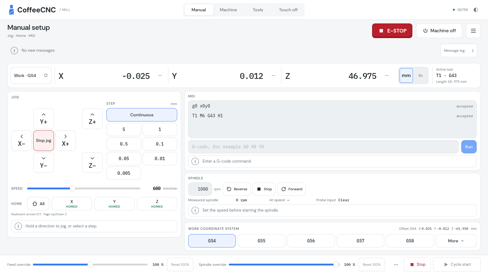
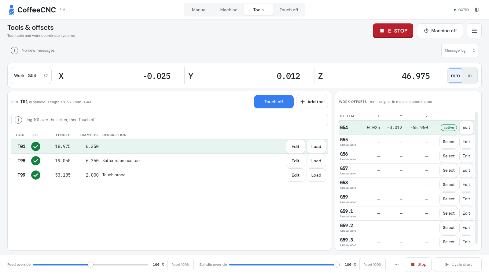

<picture>
  <source media="(prefers-color-scheme: dark)" srcset="ui/public/branding/coffeecnc-logo-dark.svg">
  
</picture>

CoffeeCNC is a touch-first operator panel for LinuxCNC milling machines. A native C++ application connects to LinuxCNC. A Vue/TypeScript interface runs inside a GTK/WebKit window on the machine controller.

LinuxCNC continues to own motion, interpretation and real-time control. CoffeeCNC gives the operator a clear screen for each step of the job: set up, measure tools, find the material, and run the program.

CoffeeCNC is a LinuxCNC display program, like AXIS or Gmoccapy: it runs on any LinuxCNC 2.9 milling machine with X, Y and Z axes. It is developed on a Grizzly G0759 mill with a Mesa 7i76e ([configuration](docs/machines/g0759.md)).



## Install

1. Download the `.deb` for Debian 13 (amd64 or arm64) from the [releases](https://github.com/tinic/coffeecnc/releases).
2. Install it with `sudo apt install ./coffeecnc_<version>_<arch>.deb`. It needs LinuxCNC 2.9 (`linuxcnc-uspace`) from linuxcnc.org.
3. Set `[DISPLAY] DISPLAY = coffeecnc` in your machine's INI file and add the CoffeeCNC HAL file.

[Set up CoffeeCNC on your machine](docs/setup.md) gives each step, the INI keys and the optional functions (tool setter, touch probe, Z jog during a pause).

## Features

### Manual

- Jog continuously or in steps from 0.005 mm. Jogging stops immediately when the touch probe or the tool setter makes contact. This is not an E-stop.
- Home each axis or all axes, enter MDI commands, and control the spindle and coolant. On a machine that homes on the reference marks of its scales, the Home buttons show which marks are known and which axis stands at its mark.
- Large coordinates show work, machine or distance-to-go positions, in mm or inches.
- Numeric fields accept formulas such as `1/4in` or `7mm/2`. See [numeric entry](docs/numeric-entry.md).
- Each card shows its own status line, for example why MDI is not available now. Machine-wide states, such as "Machine is off", show once at the top.

### Tools



- The tool table shows which tool lengths are measured and valid.
- **Touch off** measures the loaded tool on a fixed tool setter. Teach the setter once with the reference tool (T98), or with any tool that already has a valid length.
- **Load** confirms a manual tool change and applies its length offset. The last tool in the spindle comes back after a restart.
- Edit the origins of G54–G59.3 with a before/after confirmation.
- Each tool can have a 3D shape for the preview: end mills, ball-nose, bull-nose, chamfer and face mills, drills or a touch probe. See [the tool workflow](docs/design/tools-workflow.md) and [tool models](docs/design/tool-models.md).

### Touch off


- With the touch probe (T99) loaded, probe the **Z top** or one workpiece edge: **X−** (left), **X+** (right), **Y−** (front) or **Y+** (back). The diagram shows which face each button probes.
- **Corners** (X− Y−, X+ Y−, X− Y+, X+ Y+): probe Z top first, then jog the ball over the part within 10 mm of both edges. CoffeeCNC goes down beside each face and sets X0 and Y0 together.
- **Bore centre** and **Boss centre** set X0 and Y0 at the centre and show the diameter.
- **3 points: Bore** and **Boss** set X0 and Y0 at the centre of the circle through three contacts in directions you choose, and show the diameter. Use them on a partial bore or boss, or where a 4-point cycle cannot reach. The directions must be at least 10° apart and cover at least 90° of the circle. The result shows the estimated centre uncertainty. CoffeeCNC sets nothing when the contacts lie almost on a line, when the centre is uncertain by more than 0.02 mm, or when a boss differs from its entered diameter by more than 0.5 mm or 10 %.
- **Edge angle** probes the front or left edge at two points and measures its angle from the current work axes. **Apply rotation** adds that angle to the active G5x rotation, so a second measurement after applying shows the turn that is left.
- In a rotated work system, every probe cycle moves along the rotated X and Y axes and sets the origin in them. Ball calibration needs a work system without rotation.
- **Calibrate ball** measures the effective ball diameter on a gauge of known width and saves it to the tool table.
- Each probe mode opens a 3D guide with the jog position, cycle limits, and expected result. Play or step through the moves, then tap **Start probe** once the tool is in position. [Corner guide](ui/screenshots/probe-guide-corner-light.png) · [Edge-angle guide](ui/screenshots/probe-guide-angle-dark.png)
- Every move between contacts runs with the probe active, so an unexpected contact stops the machine. Nothing is written unless every contact succeeds.
- Results go into the active work coordinate system. Edge results include the probe ball radius.
- The probe can teach the tool setter, so you do not need to measure T98 first when the tool lengths are valid.

### Machine


- Open an NC program and look at the interpreter-generated toolpath before you run it. See [preview](docs/preview.md). Recently opened programs are listed first in **Open program**.
- The code list colors G-code by meaning and follows the running line. Choose Light, Dark, Sandstone or Harbor under Settings → Theme.
- The tool sequence lists each section, its tool, its lines and its estimated time. The status line shows the run state, cycle time and program line. The time tooltip includes the last run time and part count.
- **Program check** lists the tools and their lengths, the work extents and lowest Z, feed and spindle ranges and the program units. Errors block Cycle start; warnings need a confirmation.
- **Restart** from any line or tool section. The restart sheet shows the state at that line and the approach: Z to clearance, the tool change if needed, X and Y, spindle and coolant, then a slow feed down. After a Stop, an E-stop or a power loss, the Machine tab offers **Restart there** at the line where the program stopped.
- **Run to line** pauses before a chosen line; Resume continues from there.
- During a pause, jog **Z** up to inspect or clear chips. CoffeeCNC stops the spindle if needed, and Resume returns Z, restarts the spindle at speed, then continues.
- Select a line in the code list and tap an underlined F or S number to change it. CoffeeCNC changes that number in the file and opens the program again.
- Use **STEP** in the preview toolbar to attach or show a model in the work coordinate system.
- Cycle start, feed hold, stop, and feed and spindle overrides are always at the bottom of the screen.
- [Air-cut programs](samples/air/README.md) let you try all of this without material.

<details>
<summary>Dark theme</summary>


</details>

The G0759 screenshots come from the controller. The Machine screenshots come from the browser simulator.

## Try it in the browser

[Open the CoffeeCNC demo](https://tinic.github.io/coffeecnc/?scene=running&tab=program&theme=light): the full panel against a simulated machine, running in your browser. Nothing on the page talks to a real machine. Jog, home, open and run the sample programs, change overrides, restart from a line. [Touch off in the demo](https://tinic.github.io/coffeecnc/?scene=probe&tab=probe) has a touch probe (T99), a tool setter with its reference tool (T98), end mills and test parts: try the probe guides, corners, bore and boss, and measure tool lengths on the setter.

To run it locally:

```sh
cd ui
npm ci
npm run dev
```

See [UI development and checks](ui/README.md).

## View the machine on your LAN

Set a port in the machine's INI file to enable the read-only screen when CoffeeCNC starts.

```ini
[COFFEECNC]
REMOTE_PORT = 8787
```

From a device on the home LAN, open `http://<machine-hostname>:8787`, `http://<machine-ipv4>:8787`, or `http://[<machine-ipv6>]:8787`. The viewer shows live coordinates, machine state, the loaded program, its toolpath and messages. It also previews a STEP file with the same base name beside the loaded program, up to 25 MiB. The gear opens theme and language settings for this browser. It serves up to eight simultaneous viewers with HTTP and WebSocket, without sign-in. Leave the key out or set it to `0` to disable the listener.

The viewer accepts the machine's hostname, its short name and `<short-name>.local`, and names from the system DNS search domains that resolve to the machine. It refreshes discovery after address changes such as a DHCP lease. For a custom DNS alias, add `REMOTE_HOSTS = mill.example.local` under `[COFFEECNC]`. Separate multiple hostnames with spaces or commas and leave out the port.

On a trusted home LAN, add `REMOTE_UPLOAD = yes` under `[COFFEECNC]` to enable **Upload program** on the viewer. Browse for a file or drop it into the upload dialog. CoffeeCNC saves program text up to 16 MiB to `[DISPLAY] PROGRAM_PREFIX`. Replacing an existing file requires selecting **Replace existing file**. A running or paused program keeps its file. Open an uploaded program from the machine panel to review and run it.

On the machine panel, open the program browser and choose **USB** to find a file. Its row menu can copy it to **Programs**. The browser can create folders, rename items and delete files or empty folders inside **Programs**. Open a different program before renaming or deleting the loaded file or its folder.

## Build from source

The native application builds with CMake and packages as a Debian package for the controller. A `v*` tag builds and publishes the packages ([release workflow](.github/workflows/release.yml)). See [the backend build](backend/README.md) and [packaging](docs/packaging.md). The tests include LinuxCNC simulation scenarios for jogging, tool setting and probing.

## Design

- A native C++ application owns the LinuxCNC connection and the command lifecycle. Separate command, status and HAL threads keep jog-stop handling independent of blocked NML commands.
- GTK/WebKit hosts the local web UI through an in-process message bridge.
- Plain G-code is a first-class input. STEP models, setup sheets and CAM metadata add to a job when they are available.
- Machine settings and HAL integration stay separate from the shared application code. See [setup](docs/setup.md) and [the G0759 configuration](docs/machines/g0759.md) as an example.

More: [architecture](docs/architecture.md), [native shell](docs/shell.md), [product brief](docs/product-brief.md), [machinist workflows](docs/research/machinist-workflows.md), [sample catalog](samples/README.md), [logo and identity](docs/design/branding/README.md).

## License

CoffeeCNC is released under the [MIT License](LICENSE). The package also ships the licenses of what it bundles in `/usr/share/doc/coffeecnc/third-party`: Vue and three.js (MIT), occt-import-js (LGPL-2.1, used as a separate WebAssembly file), nlohmann/json (MIT) and the SM-101 sample model (MIT). Third-party sample files in `samples/upstream` keep their own upstream licenses and attribution.
