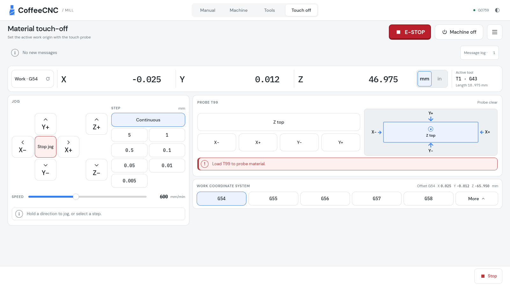
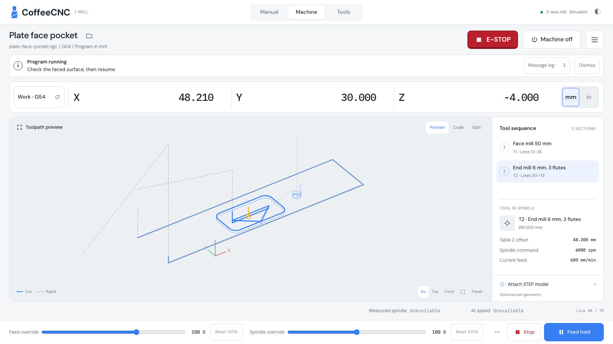
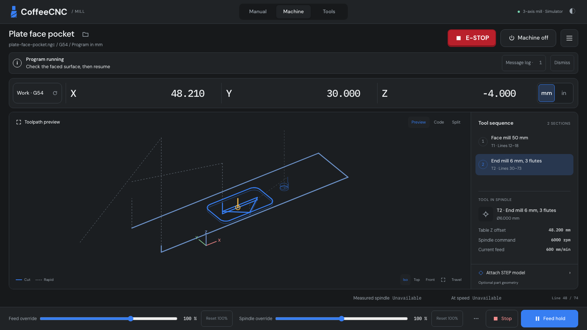

<picture>
  <source media="(prefers-color-scheme: dark)" srcset="ui/public/branding/coffeecnc-logo-dark.svg">
  
</picture>

CoffeeCNC is a touch-first operator panel for LinuxCNC milling machines. A native C++ application connects to LinuxCNC. A Vue/TypeScript interface runs inside a GTK/WebKit window on the machine controller.

LinuxCNC continues to own motion, interpretation and real-time control. CoffeeCNC gives the operator a clear screen for each step of the job: set up, measure tools, find the material, and run the program.

CoffeeCNC runs on a Grizzly **G0759** mill with a Mesa 7i76e, using the machine definitions in [tinic/linuxcnc](https://github.com/tinic/linuxcnc).


## Features

### Manual

- Jog continuously or in steps from 0.005 mm. Jogging stops immediately when the touch probe or the tool setter makes contact. This is not an E-stop.
- Home each axis or all axes, enter MDI commands, and control the spindle and coolant.
- Large coordinates show work, machine or distance-to-go positions, in mm or inches.
- Numeric fields accept formulas such as `1/4in` or `7mm/2`. See [numeric entry](docs/numeric-entry.md).
- Each card shows its own status line, for example why MDI is not available now. Machine-wide states, such as "Machine is off", show once at the top.

### Tools


- The tool table shows which tool lengths are measured and valid.
- **Touch off** measures the loaded tool on a fixed tool setter. Teach the setter once with the reference tool (T98), or with any tool that already has a valid length.
- **Load** confirms a manual tool change and applies its length offset. The last tool in the spindle comes back after a restart.
- Edit the origins of G54–G59.3 with a before/after confirmation.
- Each tool can have a 3D shape for the preview: end mills, ball-nose, bull-nose, chamfer and face mills, drills or a touch probe. See [the tool workflow](docs/design/tools-workflow.md) and [tool models](docs/design/tool-models.md).

### Touch off



- With the touch probe (T99) loaded, probe the **Z top** or one workpiece edge: **X−** (left), **X+** (right), **Y−** (front) or **Y+** (back). The diagram shows which face each button probes.
- The result goes into the active work coordinate system. Edge results include the probe ball radius.
- The probe can teach the tool setter, so you do not need to measure T98 first when the tool lengths are valid.

### Machine



- Open an NC program and look at the interpreter-generated toolpath before you run it. See [preview](docs/preview.md).
- The tool sequence lists each section, its tool and its lines.
- Attach a STEP model to show the stock or part in the work coordinate system.
- Cycle start, feed hold, stop, and feed and spindle overrides are always at the bottom of the screen.

<details>
<summary>Dark theme</summary>



</details>

The G0759 screenshots come from the controller. The Machine screenshots come from the browser simulator.

## Try it in the browser

The browser simulator runs the full interface against a simulated machine. You do not need LinuxCNC.

```sh
cd ui
npm ci
npm run dev
```

Open [the simulated Machine workspace](http://127.0.0.1:5174/?scene=running&tab=program&theme=light). The simulator does not include the tool setter or the touch probe. See [UI development and checks](ui/README.md).

## Build and install

The native application builds with CMake and packages as a Debian package for the controller. See [the backend build](backend/README.md) and [packaging](docs/packaging.md). The tests include LinuxCNC simulation scenarios for jogging, tool setting and probing.

## Design

- A native C++ application owns the LinuxCNC connection and the command lifecycle. Separate command, status and HAL threads keep jog-stop handling independent of blocked NML commands.
- GTK/WebKit hosts the local web UI through an in-process message bridge.
- Plain G-code is a first-class input. STEP models, setup sheets and CAM metadata add to a job when they are available.
- Machine settings and HAL integration stay separate from the shared application code. See [the G0759 configuration](docs/machines/g0759.md).

More: [architecture](docs/architecture.md), [native shell](docs/shell.md), [product brief](docs/product-brief.md), [machinist workflows](docs/research/machinist-workflows.md), [sample catalog](samples/README.md), [logo and identity](docs/design/branding/README.md).

## License

A project-wide license is not selected yet. Third-party sample files keep their own upstream licenses and attribution.
