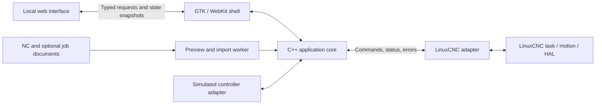

# Architecture

CoffeeCNC is an independent application. The agreed direction is a native C++ core with a GTK-hosted web UI, informed by Elle. The Vue/TypeScript operator panel and portable C++ core/session libraries are implemented; the LinuxCNC adapter and native shell integration remain in progress. This document records boundaries and remaining design work.

## What Elle demonstrates

Elle was inspected at [commit 9918ae6](https://github.com/tinic/el-linuxcnc-electron/tree/9918ae63a4b038811ca5b42186e7d8ba382f386d). At that revision, its C++23 application uses WebKitGTK to host a Vue/TypeScript interface, a local script-message bridge, a userspace control loop and a separate NML worker for canned-cycle commands. Domain logic and LinuxCNC I/O are separated, with simulation support for development. The project owner's experience with this simplification motivates CoffeeCNC's direction.

The relevant boundaries are visible in its [native shell](https://github.com/tinic/el-linuxcnc-electron/blob/9918ae63a4b038811ca5b42186e7d8ba382f386d/backend/src/shell/panel_window.cpp), [task client](https://github.com/tinic/el-linuxcnc-electron/blob/9918ae63a4b038811ca5b42186e7d8ba382f386d/backend/src/linuxcnc/src/task_client.cpp), [control loop](https://github.com/tinic/el-linuxcnc-electron/blob/9918ae63a4b038811ca5b42186e7d8ba382f386d/backend/src/app/src/control_loop.cpp) and [UI bridge](https://github.com/tinic/el-linuxcnc-electron/blob/9918ae63a4b038811ca5b42186e7d8ba382f386d/ui/src/bridge.ts).

That is architectural evidence, not a requirement to copy the lathe domain, polling rates or application source into a milling product.

## Native responsibilities

The C++ core should own controller connection lifecycle, mode/state transitions, command validation and completion tracking, configuration, file identity and job associations. The adapter isolates LinuxCNC-specific status structures and command details from the UI model.

LinuxCNC documents commands, status and errors as separate channels and exposes its NML interface through C++, with a supported Python wrapper. That makes C++ a direct integration choice; it does not imply that Python is unsuitable for every LinuxCNC UI. Rust would require its own binding strategy at this boundary. [LinuxCNC interface documentation](https://linuxcnc.org/docs/stable/html/config/python-interface.html)

The application core is userspace code. LinuxCNC remains responsible for interpreting the program and executing motion. A high UI update rate does not turn a webview or a native event loop into a real-time controller.

## UI contract

Use a versioned, typed local message protocol. UI requests should express an action and its arguments; the core validates that action against current controller state. A request accepted by the bridge is not automatically a completed controller command. Represent pending, accepted, completed, rejected and timed-out outcomes explicitly where relevant.

Publish state with sequence/freshness information. Distinguish actual from commanded values, selected from loaded tools, controller state from preview state, and imported metadata from operator declarations. Reconnecting the webview should restore observed state without replaying motion commands.

The web UI should not build arbitrary command strings from presentation state. MDI is an explicit operator workflow with its own command/result history. File/document content is data, not executable UI markup. Bundle production assets locally; the existing concept's CDN dependencies are prototype scaffolding.

## Input and physical controls

Jogging requires deliberate start/stop semantics and consideration of release, focus loss, disconnect and controller-mode changes. Keyboard focus in an editor must not accidentally become a motion command. Pendant/MPG and physical controls need to remain compatible with the configured LinuxCNC system. Their state must be reflected in the UI rather than overwritten by a stale slider position.

These behaviors require LinuxCNC simulation tests and machine-specific integration work. A decorative emergency-stop button is not a substitute for the machine's configured emergency-stop system.

## Program and model handling

The baseline job is a program plus controller/setup context. Optional attachments include STEP, drawings, setup sheets, tool lists and CAM operation metadata. Associate them by explicit identity/revision and setup transform. Keep conflicting values available with provenance.

Preview generation must honor the relevant LinuxCNC interpreter semantics and configuration. Investigate reuse of LinuxCNC's interpreter/canonical-motion facilities before choosing an implementation. The C++ product direction does not require reimplementing every existing preview facility from scratch or pretending a line scanner is an interpreter.

CAD tessellation and preview computation should run outside the UI event loop. Treat these outputs separately: intended part geometry, starting stock, commanded toolpath, executed backplot and simulated remaining stock. STEP alone supplies none of the missing fixture/tool/registration evidence.

For display-only STEP import, the panel now uses a pinned `occt-import-js` package in a cancellable Web Worker. A separate Three.js layer shares the toolpath camera; explicit model placement is tied to a program revision and work frame. Changed work coordinates hide the model for review, and a program reload clears the attachment. See [the library comparison, version tradeoff and integration boundary](research/step-preview.md). This does not move controller responsibilities into the webview.

## Machine configuration

The G0759 is the first integration target, using the owner's separate `tinic/linuxcnc` repository. See [the pinned configuration review](machines/g0759.md). Its XYZ/mm kinematics fit the current scope, but custom spindle settings, manual tool-change HAL, external position feedback and homing policy need explicit integration. Machine profiles should map configuration and optional signals into typed capabilities; UI components must not switch behavior on a machine name. Keep hardware HAL and machine-scoped persistence separate from shared controller logic.

## Implementation decisions still open

- Exact supported LinuxCNC, GTK and WebKitGTK versions and packaging targets.
- Preview/interpreter adapter and its treatment of remaps, macros and probe-dependent code.
- Persistent model/job associations, native WebKit validation and stronger import memory isolation.
- Job metadata format and CAM-post integrations.
- G0759 capability/configuration mapping, optional feedback status and future automatic tool-change support.

The browser simulator now exercises mode/command/error states and the [operator walkthroughs](research/machinist-workflows.md). Native LinuxCNC simulation, a G0759-shaped fixture and WebKitGTK qualification precede machine trials.
