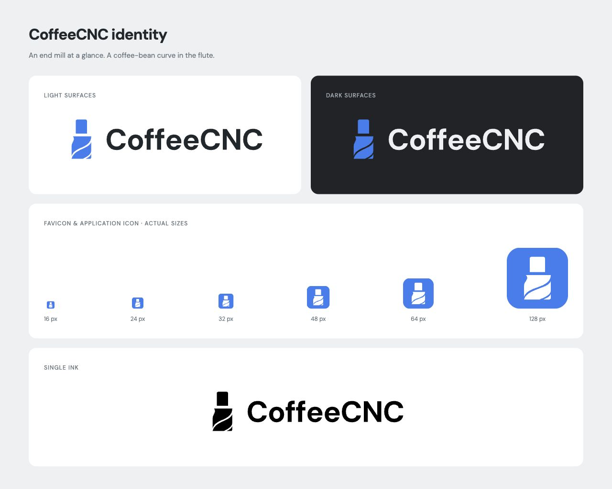
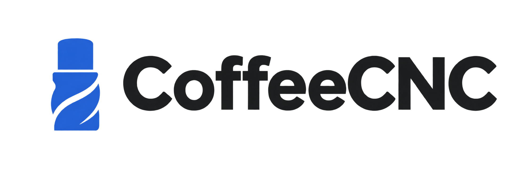
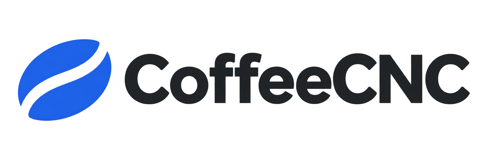

# CoffeeCNC identity

<picture>
  <source media="(prefers-color-scheme: dark)" srcset="../../../ui/public/branding/coffeecnc-logo-dark.svg">
  
</picture>

The production mark uses an end mill's straight shank, shoulder, helical flutes
and flat cutting tip. Its curved flute retains the coffee-bean reference.
The wordmark uses outlined DM Sans Bold, matching the interface's type family.
All SVGs contain paths, with no external font, bitmap or network dependency.



## Assets

| Asset | Use |
| --- | --- |
| [Light logo](../../../ui/public/branding/coffeecnc-logo-light.svg) | Light surfaces; blue mark and graphite wordmark |
| [Dark logo](../../../ui/public/branding/coffeecnc-logo-dark.svg) | Dark surfaces; blue mark and pale wordmark |
| [Monochrome logo](../../../ui/public/branding/coffeecnc-logo-mono.svg) | Single-ink use; `currentColor`, black by default |
| [Mark](../../../ui/public/branding/coffeecnc-mark.svg) | Standalone blue end mill |
| [Square icon](../../../ui/public/branding/coffeecnc-icon.svg) | Favicon and app icon; white mark on blue |
| [512 px PNG](../../../ui/public/branding/coffeecnc-icon-512.png) · [180 px PNG](../../../ui/public/branding/coffeecnc-icon-180.png) | Raster app icon and Apple touch icon |

The UI header selects its logo from the application's light/dark setting.
The favicon and touch icon are included in the browser entry point. The SVG
icon is also available for native packaging; installing a desktop launcher
icon is a separate backend task. See the [asset sheet](assets.html) for both
surfaces and icon sizes from 16 to 128 px.

Keep the aspect ratio, allow at least half a shank's width of clear space, and
use the square icon when the wordmark would be too small to read. Brand blue is
`#377ef2`, graphite is `#20272c`, and the dark-surface wordmark is `#edf0f2`.

## Editable source and regeneration

[coffeecnc-mark-source.svg](coffeecnc-mark-source.svg) is the hand-drawn vector
master. [build-branding.py](../../../scripts/build-branding.py) combines it with
the bundled DM Sans font at weight 700 and exports the outlined lockups. The
font's original [SIL OFL notice](../../../ui/public/fonts/dmsans-OFL.txt) remains
in the repository and UI distribution. No additional runtime dependency is added.

From the repository root, with Python 3 and `rsvg-convert` available:

```sh
python3 -m venv /tmp/coffeecnc-branding-venv
/tmp/coffeecnc-branding-venv/bin/pip install 'fonttools[woff]==4.68.0'
/tmp/coffeecnc-branding-venv/bin/python scripts/build-branding.py
rsvg-convert -w 512 -h 512 ui/public/branding/coffeecnc-icon.svg -o ui/public/branding/coffeecnc-icon-512.png
rsvg-convert -w 180 -h 180 ui/public/branding/coffeecnc-icon.svg -o ui/public/branding/coffeecnc-icon-180.png
```

## Verification

The production UI check passed type checking, lint and 339 tests. The final
production build and panel source/asset stamp check passed. Browser review
covered both themes, eager loading of both wordmarks during theme changes,
actual-size icons from 16 to 128 px, and the Manual layout. The retained
[light](../../../ui/screenshots/branding-manual-light.png) and
[dark](../../../ui/screenshots/branding-manual-dark.png) captures are 1600 × 900
browser fixtures, with no console warnings or errors in the checked flow.
Native packaging and physical-touch verification remain separate.

## Generated concepts



The revised mark makes the milling connection explicit: a short end mill with
a shank, shoulder, helical flutes and flat cutting tip. The curved cut retains
the first concept's coffee-bean reference. The wordmark and blue palette follow
the application's simple industrial style.

Generated on 15 November 2026 with the built-in image-generation tool using
[this revision prompt](coffeecnc-logo-cutter-v2-prompt.txt) and the first logo
as its edit reference. The PNG preserves transparency.
The user approved proceeding with this milling-focused direction. The vector
assets above simplify its geometry and replace the raster lettering with the
interface's existing font. The original generated artwork and prompt are
preserved here. Deployment to the native controller is tracked separately.

## First direction



The original abstract bean suggested a cutter's flute through negative space.
The user's feedback was to make the milling-machine connection more obvious,
which led to the end-mill version above. [Original prompt](coffeecnc-logo-prompt.txt).
