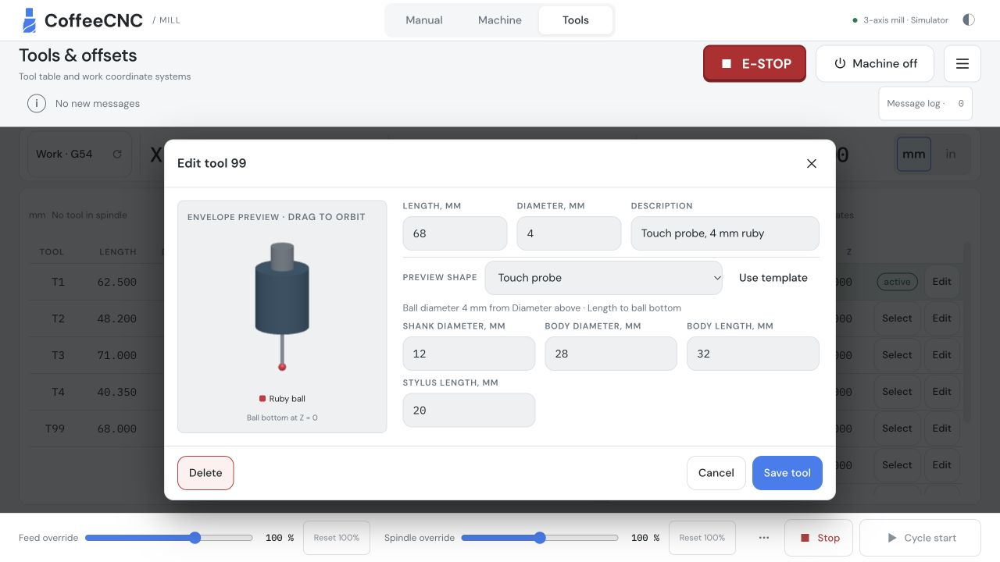

# Parametric tool models

The Tools workspace opens one editor for tool details and **Preview shape**, with a live 3D envelope on the left. Type selection and dimensions are directly editable, without Override checkboxes. **Settings → Tool shape templates** configures starting proportions; **Use template** fills them into the current draft. Families cover flat end mills, ball-nose end mills, drills, spot drills, chamfer mills, face mills and a generic cylinder. An unassigned tool with a positive diameter starts with an unsaved flat-end-mill draft; comments and T numbers do not infer its type. **No preview shape** removes the assignment when saved.

## Dimensions and inheritance

Each cutter template has a reference cutting diameter, cutting length, shank diameter, overall length, stick-out and included tip angle. These are nominal starting proportions, not a manufacturer's specification. Choosing a cutter type or Use template scales its lengths to the current table diameter; the angle stays fixed. The combined editor reads cutting diameter from its Diameter field and requires a positive diameter before saving a shape. Saved dimensions are absolute millimetres and remain fixed when the diameter changes until the operator changes them or uses the template again. Legacy inherited assignments remain supported; a legacy missing/zero diameter uses the template diameter with a nominal-diameter notice. The editor converts from the selected mm/inch display unit and keeps that unit fixed while open.

The LinuxCNC table's Z offset (`Tool.length`) never supplies physical length. Touching off a tool changes that offset without changing its visual model. The combined editor can change the table's Length and Diameter fields; changing shape dimensions alone does not change table offsets or send motion commands. Save tool waits for acknowledgement and readback of table changes before binding the shape to the updated row. If the shape save then fails, the editor reports the partial result and retains the draft.

The current envelope constraints require finite positive dimensions, cutting length no greater than stick-out, stick-out no greater than overall length, and some shank beyond the cutting section. Ball ends must fit a full radius in the cutting length. Pointed families must fit the cone implied by the included angle. Unsupported tools such as tapered, bull-nose, thread, dovetail and form cutters need additional profiles; use an explicitly nominal generic envelope until those profiles exist.

## Geometry contract

The cutting tip is `(0, 0, 0)`; the body extends along **+Z**, in millimetres. `toolProfiles()` supplies radius/height sections independently of the renderer. The Three.js [LatheGeometry](https://threejs.org/docs/pages/LatheGeometry.html) renderer rotates its native +Y axis to +Z. Cutting and shank surfaces use distinct materials. The blue ring is a holder-face datum at `Z = stickout`, not a holder mesh.

The full physical tool is displayed, including the section above that datum. Flutes, individual inserts and holders are not represented. Drill/spot/chamfer tips are ideal sharp cones; ball ends are hemispherical. These are visual envelopes, not collision or material-removal simulation. The Machine workspace now places the configured loaded-tool envelope at the reported tip in the shared STEP scene. The toolpath and tip marker remain on top, so this is not an occlusion test.

## Placement in the Machine workspace

The body uses `Status.tool.in_spindle`, never a prepared T word or the selected tool-sequence section. Its anchor is `Axis.machine - Status.offsets.tool` in millimetres, exactly once, matching the toolpath's tip convention. G5x, G92 and work rotation do not transform this machine-space point. The model's physical overall length and table Z offset never supply an additional translation. This first renderer assumes the supported XYZ mill with its spindle along machine Z.

The body is hidden when the link is stale/down, an axis is unhomed/homing, a manual tool change is in progress, the loaded row is missing/unassigned, or its dimensions are invalid. The existing tip marker remains available where position is known. **Tool** toggles the envelope independently of **Part**. **Fit**, named views and initial view sizing include the visible body; live motion does not refit the camera. Tool and part share one WebGL renderer and camera. Geometry rebuilds only when its model changes; arriving positions translate the existing mesh.

The banner identifies the loaded T number and absent holder, and flags a nominal diameter if the table has none. The current protocol describes controller coordinates, not an independently measured cutter position. This display does not establish the physical length, offset correctness or collision clearance of the mounted assembly.

## Touch probe

Choose **Touch probe** as the preview shape of a numbered tool. T99 is suggested when adding one. Set Diameter to the effective ball diameter and touch off Length at the bottom of the ball. The model uses that point as Z zero. Shank diameter, body diameter, body length and stylus length are editable. Stylus length runs from the top of the ball to the housing. The shank above the housing is drawn one shank diameter tall. Template dimensions stay fixed when the ball diameter changes.

Native CoffeeCNC uses the saved tool number and LinuxCNC's reported spindle tool to reject Forward and Reverse when a touch probe is loaded. The classification stays in effect if the row description, pocket or diameter changes. Cycle Start and Single Block require a stopped spindle and a program that passes the spindle check. Resume requires a run initially checked by CoffeeCNC. The check accepts a speed preset and M5. It refuses M3, M4, orientation and spindle-driven cycles, plus code it cannot verify, such as indirect words, subroutines and custom M-codes. Fresh runs reopen the checked path because LinuxCNC can retain an older open file after an edit. [LinuxCNC spindle commands](https://linuxcnc.org/docs/2.9/html/gcode/m-code.html#mcode:m3-m4-m5) · [LinuxCNC task source](https://github.com/LinuxCNC/linuxcnc/blob/v2.9.4/src/emc/task/emctaskmain.cc#L2153-L2162)

These checks operate at CoffeeCNC command dispatch. External control, HAL outputs, machine remaps and tool changes during execution have their own behavior. The touch probe classification requires a saved machine catalog in native sessions.

## Storage and lifetime

The browser demonstration stores validated family defaults under `coffeecnc.tool-model-defaults.v1`; its per-tool assignments remain page-local. Native sessions never consult that browser key, including native LinuxCNC simulations and older backends without persistence support.

The native panel uses the [machine-scoped storage contract](native-tool-model-storage.md) when the backend advertises `tool_model_storage: 1`. It waits for a validated document belonging to the current hello identity. Family defaults save together; each assignment saves separately without replacing the catalog. The editor keeps its opening revision, retains failed drafts, and waits for both a new authoritative snapshot and accepted result before closing. Timeout does not prove cancellation. Save errors remain visible outside the scrolling form. Older peers or a missing configured identity use explicitly labeled session-only models; corrupt, unsupported or locked storage disables native saves.

Saved assignments use number, pocket, exact reported mm diameter and description. Z touch-off preserves an assignment. Changed/deleted rows or stale/missing tables withhold the usable model without deleting the saved entry. A new hello clears settings and active assignments; it also requires a fresh tool table. This does not establish physical tool identity when a cutter is replaced without changing the table row. The backend writer and native editor pass save and full LinuxCNC/application restart checks; see the [completed integration review](../research/evidence/native-tool-models-06ae603-review.txt). Actual power-loss durability and application-only restart under a still-running LinuxCNC remain unqualified.

Changing defaults affects tools that inherit them; overridden lengths remain fixed. A combination made invalid by a later family-default change is labeled **Review model** and must be corrected before rendering.

## Sample-driven follow-up

The expanded corpus supplies useful next cases without justifying automatic tool-table population:

- Camcraft's `ops_3d_ramp*.nc` names a D6/R3 ball end mill; its chamfer and engraving fixtures exercise 90° pointed cutters. These are good visual family/shape references.
- EngiWorld's `tool_candidates.csv` names D16/D10/D8 end mills and D14/D12 drills, but provides no shank or stick-out dimensions. Missing geometry must remain nominal.
- Trebuchet's `tools.json` includes cutting and shank diameters, flute/overall length and a holder with its own inch units beside metric tools. An importer needs explicit unit conversion and tool/holder assembly handling.
- SM-101's tool JSON conflicts with its NC revision for T4, as documented in the sample catalog. Metadata import needs conflict review, not silent assignment.

Later increments can add setup-specific stick-out, manufacturer/CAM imports with provenance, and toolholders separately. The loaded-tool renderer follows that reported-tool/tip convention; future holders and other machine kinematics must retain explicit coordinate and unit contracts.
