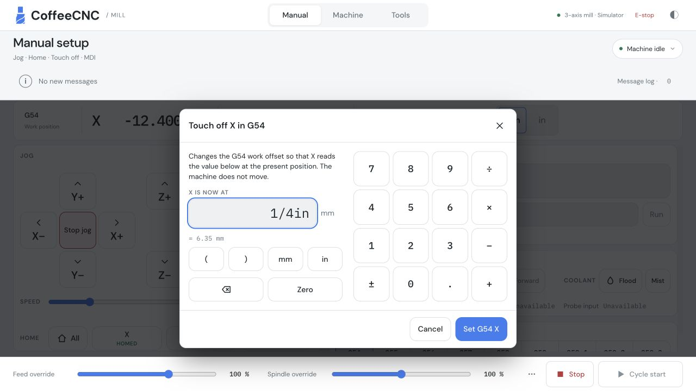

# Numeric entry

Numeric editors accept arithmetic with `+`, `-`, `*`/`×`, `/`/`÷`, parentheses and decimal commas. The keypad includes operators, parentheses, and `mm`/`in` buttons for length fields. It previews the evaluated value before confirmation.

| Entry | Length in millimeters |
| --- | ---: |
| `1/4in` | 6.35 |
| `7mm/2` | 3.5 |
| `7/2mm` | 3.5 |
| `(1in + 2mm)/2` | 13.7 |

Bare numbers use the field's displayed units. Explicit length units convert to that display unit, then the normal command boundary converts to protocol millimeters. A unit qualifies its multiplicative term: both `7/2mm` and `7mm/2` mean 3.5 mm. Mixed-unit sums such as `1in+2mm` are accepted. Area expressions and division by explicitly dimensioned parentheses are rejected.

This applies to coordinate and tool touch-off, tool-table dimensions and numbers, tool-model dimensions and angles, STEP placement offsets and rotations, and spindle RPM. RPM and angles accept arithmetic with their own optional suffix (`rpm`, `deg`/`°`). Integer fields still require an integer result. Units incompatible with the field are rejected, as are division by zero, nonfinite values and incomplete expressions.

Entering a formula does not change the confirmation behavior. Coordinate changes require the named Set action. A running spindle changes speed only on Enter or **Set RPM**; Escape or blur discards an unconfirmed keyboard edit. Confirming while stopped stores a preset for the next explicit Forward/Reverse action.

Validation on 16 November 2026: typecheck, lint, 425 UI tests in 30 files, production build and matching build stamp. Tests include the requested expressions in both mm and inch modes, touch-keypad confirmation, actual touch-off command values, invalid expressions and RPM confirmation. Browser checks at 1280 × 720 confirmed every keypad control fits without scrolling, `1/4in` previews 6.35 mm, and `7/2mm` entered in inch display mode produces a 3.500 mm coordinate after switching back. No console errors. These checks used the browser simulator, not physical machine commands.
